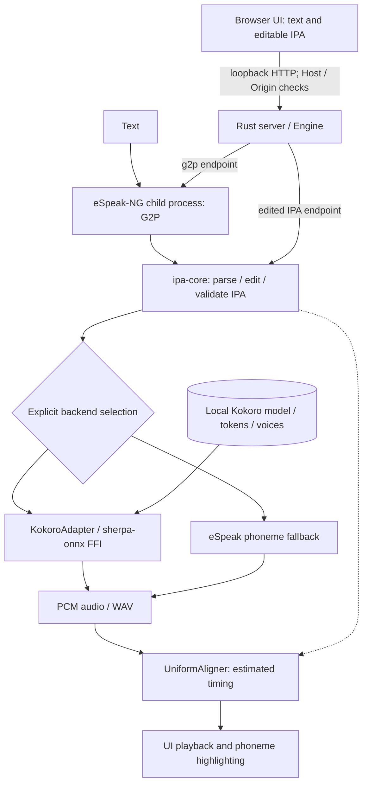

<!-- SPDX-License-Identifier: CC-BY-4.0 -->
# IPA-first TTS

Edit structured IPA before synthesizing speech locally with Kokoro / sherpa-onnx.

[简体中文与完整技术参考](README.zh-CN.md) · [v0.1.0 offline package](https://github.com/styayur/ipa-first-tts/releases/tag/v0.1.0) · [Model setup](models/README.md)

**MVP preview.** English en-US/en-GB only; other language IDs are explicitly rejected by the current entry point. The reusable `ipa-core` library has no Kokoro, sherpa-onnx or UI dependency. The app uses a Rust loopback HTTP server and plain browser UI, without npm/CDN/React/Tauri runtime dependencies.


## Download and run on Windows x64

From [v0.1.0](https://github.com/styayur/ipa-first-tts/releases/tag/v0.1.0), download `ipa-first-tts-v0.1.0-windows-x64-offline.zip`, compare its full SHA-256 with `SHA256SUMS.txt`, and extract the complete archive on Windows 10/11 x64. Run `Start-IPA-Studio.cmd` and open the local URL printed in its terminal.

The offline package includes the model, eSpeak-NG, matching sherpa/ONNX Runtime DLLs and application-local Microsoft VC++ runtime. It requires no Rust, Python, Node.js, runtime installer or network connection. Keep the package together; copying only the EXE or mixing native DLL versions can break execution. Close the terminal or press Ctrl+C to stop the server.

In the extracted directory:

```powershell
.\ipa-tts.exe doctor
.\ipa-tts.exe demo outputs\quick-brown-fox.wav kokoro
.\ipa-tts.exe synth "ˈʃiː" outputs\edited.wav kokoro
```

The release also supplies `corresponding-source.zip` with application, vendored Cargo and native upstream sources. Redistribution and source boundaries are recorded in [THIRD_PARTY_NOTICES.md](THIRD_PARTY_NOTICES.md).

## Build and quick start

Install PowerShell 7 (`pwsh`), stable Rust MSVC, Visual Studio C++ Build Tools / Windows SDK, and Windows `curl.exe` / `tar.exe`. Run from the project root:

```powershell
git clone https://github.com/styayur/ipa-first-tts.git
cd ipa-first-tts
pwsh -File scripts/setup.ps1
cargo build --workspace --locked
cargo run -p ipa-desktop -- doctor
cargo run -p ipa-desktop -- serve
```

Setup downloads pinned tools/models; the first native Cargo build downloads the matching shared CPU runtime. The source checkout does not include those assets. Runtime is offline. See [model instructions](models/README.md) for local overrides and fully offline build preparation.

Open the exact printed URL, normally `http://127.0.0.1:17842`. Generate IPA from text, edit/validate phonemes, then Synthesize. The edited phonemes reach the selected backend rather than silently regenerating them from the original text. Play/Stop controls audio; Save WAV persists it. Highlighting is explicitly **Estimated timing**. Change a conflicting port with `cargo run -p ipa-desktop -- serve 17843`.

The server binds only `127.0.0.1`, checks Host/Origin and does not enable CORS. It is not a public authenticated service.

### Recorded G2P result

From the Windows v0.1.0 offline package:

```powershell
.\ipa-tts.exe g2p "The quick brown fox jumps over the lazy dog."
```

Actual stdout recorded on 09-10-2026, exit 0 with bundled eSpeak-NG:

```text
ðə kwˈɪk bɹˈa͡ʊn fˈɑːks d͡ʒˈʌmps ˌo͡ʊvɚ ðə lˈe͡ɪzi dˈɑːɡ
```

This is text-to-IPA evidence, not a new Kokoro synthesis measurement or phoneme-alignment proof.

## Architecture

<!-- architecture:overview:start -->

<!-- architecture:overview:end -->

The CLI uses the same Engine directly. G2P runs eSpeak-NG as a child process; Kokoro adapts edited `IpaSequence` through a temporary phoneme lexicon and a native session. eSpeak is an explicitly selected fallback, not automatic recovery. `UniformAligner` divides duration across phones and reports estimated timing; no forced aligner is implemented. See [source evidence](docs/architecture/README.md), [model/runtime details](models/README.md) and the [full technical reference](README.zh-CN.md).

## Tests and platform support

From the root:

```powershell
cargo build --workspace --locked
cargo test --workspace --locked
cargo test -p ipa-desktop --test pipeline -- --ignored --test-threads=1
cargo clippy --workspace --all-targets -- -D warnings
```

Ordinary tests do not need models. The explicitly ignored pipeline tests require real eSpeak/Kokoro and matching DLLs. [CI](https://github.com/styayur/ipa-first-tts/actions/workflows/ci.yml) runs model-independent core checks on Ubuntu/Windows and native Windows build/unit tests; it does not silently certify every platform's real audio.

For a minimal eSpeak-only path without model/native Kokoro setup:

```powershell
pwsh -File scripts/setup.ps1 -SkipModel
cargo run -p ipa-desktop --no-default-features -- serve
cargo run -p ipa-desktop --no-default-features -- demo outputs/fallback.wav espeak
```

Fallback requires eSpeak, consumes the edited English phonemes, and is fixed to en-US/speaker 0. It is not Kokoro. Optional `python scripts/test_ui.py` requires Python Playwright and Chromium while the server runs; these are test dependencies. [Chinese testing details](README.zh-CN.md#build--test) explain independent core/offline checks and real UI evidence.

## Known limits and next work

- Only Windows x64 native execution has been verified. The UI is browser-based, without a native Tauri window/installer.
- IPA validation is conservative syntax/structure validation, not complete IPA or English phonology. eSpeak and Kokoro's training frontend can differ; unsupported model phonemes fail explicitly.
- G2P text is bounded to 4096 UTF-8 bytes, UI IPA to 8192 bytes, Kokoro to 480 model tokens. Split long input. Punctuation may need manual restoration; no separate prosody IR exists.
- All timing is uniformly estimated, unsuitable for pronunciation scoring. Each utterance recreates a session/lexicon, increasing latency and memory. Stop halts playback, not native inference.
- Processing is serial; malformed/mismatched native assets can crash the process. Inference is not isolated in a restartable worker. Only the latest four WAV results are cached in server memory.

Worker isolation/cancellation, a stable phoneme bridge/session cache, native packaging, measured alignment and additional language/backends remain [roadmap work](README.zh-CN.md#roadmap). Training, cloning, STT, chat and cloud services are outside scope.

## Contributing and license

Read [CONTRIBUTING.md](CONTRIBUTING.md), run applicable checks and identify untested model/device paths. Use [Issues](https://github.com/styayur/ipa-first-tts/issues) for redacted reproductions and [SECURITY.md](SECURITY.md) for vulnerabilities. Do not commit downloaded models, tools, generated audio or user settings.

The complete app/CLI/UI and combined executable use [GPL-3.0-or-later](LICENSE); reusable `crates/` use MPL-2.0; scripts/CI use MIT; original standalone Markdown uses CC BY 4.0. Historical copyright notices remain intact. Third-party models, data, native libraries and dependencies retain their own terms. See [license scope and texts](licenses/README.md), [NOTICE](NOTICE) and [THIRD_PARTY_NOTICES.md](THIRD_PARTY_NOTICES.md). This is not a blanket relicense.
